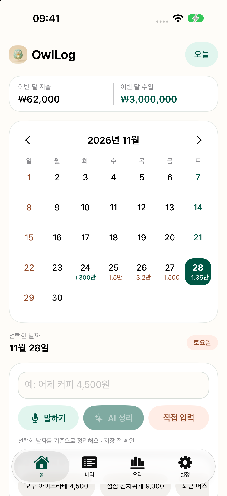
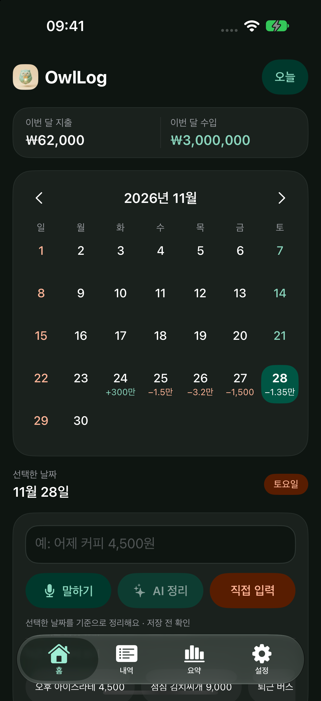

# OwlLog · MemoBooks

**“어제 커피 4500원” — 말하거나 한 줄로 남기고, 확인한 뒤 저장하는 가계부.**

[](https://github.com/Dalzoo03/MemoBooks/actions/workflows/ci.yml)


입력할 때마다 금액·날짜·분류를 고르는 수고를 줄이기 위해 만든 iPhone·Apple Watch 앱입니다. 앱 화면 이름은 **OwlLog**, Xcode 프로젝트와 저장소 이름은 **MemoBooks**입니다.
거래 해석은 Apple의 온디바이스 모델로 수행하고, 확인한 기록은 SwiftData로 기기에 저장합니다.
서버·계정·외부 AI API 없이 동작하며, AI를 사용할 수 없는 기기에서도 직접 입력할 수 있습니다.


## 화면

| 캘린더에서 바로 기록 | 다크 모드 |
|:---:|:---:|
|  |  |

[소비 요약](docs/stitch-design/previews/summary-light.png) · [전체 내역](docs/images/history.png) · [설정과 백업](docs/images/settings.png)

실제 시뮬레이터 화면입니다. 화면 속 거래는 Debug 전용 메모리 저장소의 가상 데이터이며, AI 추론 결과를 연출한 화면은 아닙니다.

## 기록하는 흐름

```text
한 줄 입력 / 기기 내 음성인식 / Watch 메모
                    ↓
명확한 금액 검증 · 흔한 날짜 표현 계산
                    ↓
기기 내 AI가 메모 · 수입/지출 · 카테고리 정리
                    ↓
금액 · 날짜 · 분류를 사용자가 확인·수정
                    ↓
SwiftData 저장 → 홈 · 달력 · 내역 반영
```

- **홈**: 월 달력과 음성·한 줄·직접 입력을 한 화면에 통합. 날짜별 수입·지출 표시, 최근 기록 다시 쓰기, 선택 날짜 기준 정리와 저장 전 확인 시트
- **요약**: 월 수입·지출·기록 차액, 남은 예산, 카테고리별 비중을 앱에서 계산
- **내역**: 날짜별 거래, 분류별 집계, 검색·필터·수정·삭제
- **데이터 관리**: JSON 백업·복원 미리보기, ID 중복 방지, 한국어 CSV 내보내기
- **Apple Watch**: 시스템 받아쓰기·짧은 입력 → iPhone 온디바이스 AI → 워치에서 금액·분류·날짜 확인·수정 → 저장. 대기 메모·미리보기 보존, 같은 ID 재시도로 중복 방지

새 Watch 기록은 워치에서 확인하고 저장할 수 있습니다. AI 분석과 최종 거래 저장은 연결된 iPhone이 담당합니다.
폰 연결·잠금·모델 준비 상태와 백그라운드 실행 제한에 따라 즉시 처리되지 않을 수 있으며, 이때 메모와 확인 결과는 워치에 보관됩니다. 저장 응답이 끊겨 재시도하면 기존 거래를 반환하고 덮어쓰거나 중복 추가하지 않습니다.
이전 버전에서 이미 전송 중이던 메모는 iPhone 홈의 워치 메모 목록에서 확인합니다. [실기기 확인 순서](docs/WATCH_TESTING.md)

Stitch 디자인의 민트·살구·라벤더 팔레트와 부엉이 이미지를 적용했습니다. iOS 기본 탭과 목록을 사용하고 다크 모드·Dynamic Type을 지원합니다. 디자인에 포함된 위젯·생성형 소비 조언·워치 오늘 지출 요약은 아직 구현하지 않았습니다. [디자인 반영 범위](docs/stitch-design/README.md)

## 설계에서 신경 쓴 점

### AI가 돈을 계산하게 두지 않기

실제 모델 평가에서 `10만원`을 `1만원`으로 읽거나 `어제`를 오늘로 처리하는 오류를 확인했습니다.
명확한 원화 금액과 `오늘·어제·그저께`, 명시 날짜, `지난달 N일`은 코드로 계산하고, AI는 메모·유형·분류를 제안하도록 바꿨습니다.
월 합계와 예산도 앱이 직접 계산합니다. 금액은 모델의 생성 대상에서 제외하고 앱이 검증한 값을 사용합니다. 일반 모델 호출 한 번으로 거래 여부·메모·날짜·분류를 확인합니다.

금액 누락·여러 금액·이체·모호한 표현은 직접 확인하도록 안내합니다. 현재 자동 분석은 **`원`이 붙은 숫자 금액 또는 문장 끝의 숫자 금액 하나**를 지원합니다. `삼겹살 6000`, `커피 4천5백원`도 처리합니다. 수량 등 다른 숫자가 섞이거나 지원하지 않는 표현은 직접 입력으로 처리할 수 있습니다.
이 검증은 모든 모호함이나 입력 안의 지시문을 판별하는 보장은 아니므로, 저장 전 사용자 확인을 유지합니다.

### 실패해도 메모를 잃지 않기

Watch는 분석 요청 전에 메모를 별도 파일에 원자적으로 저장하고, 확인 결과와 저장 재시도에 필요한 ID도 보관합니다. 보관에 실패하면 입력창을 지우지 않습니다.
여러 전송이 실패해도 각각 남고, 재전송에는 원래 ID를 사용해 iPhone의 중복 수신 방지와 연결합니다.
새 기록은 최종 저장 응답을 받아야 대기 목록에서 제거합니다. 이전 버전 전송은 재시작 시 시스템 대기열과 비교해 복구합니다.

### 기존 기록을 유지하는 백업

이전 `Expense` 필드는 유지하고 새 필드는 optional로 추가했습니다. 백업 시 기존 행에도 영구 UUID를 부여합니다.
복원은 모든 기록을 먼저 검증한 뒤 신규 ID만 추가하며, 기기에서 수정한 기존 내용을 덮어쓰지 않습니다.
파일 읽기·검증과 JSON/CSV 변환은 백그라운드에서 처리하고, 처리 중 표시와 중복 실행 방지를 제공합니다.
백업은 20MB·5만 건 한도이고, 거래만 포함합니다. 예산·작성 중 문장·Watch 대기 메모는 제외합니다.

## 기술 구성

| 역할 | 사용 기술 |
|---|---|
| 화면 | SwiftUI, 시스템 색상, Dynamic Type, 접근성 레이블 |
| 로컬 저장 | SwiftData, UserDefaults(설정·작성 중 문장), 파일 기반 Watch 발신함 |
| 거래 해석 | Foundation Models · `SystemLanguageModel(.general)`, `@Generable`, `@Guide` |
| 음성 | Speech · AVFoundation, 기기 내 한국어 인식만 허용 |
| Watch 전송 | WatchConnectivity · `sendMessage` 요청·응답, 이전 메모는 `transferUserInfo` |
| 검증 | Swift 실행 검사, 실제 SwiftData 저장소 이전·복원 검사, GitHub Actions |

```text
MemoBooks/
├── App/            앱 시작, 저장소, 탭
├── Features/       홈·기록·달력·내역·설정
├── Models/         거래 모델, 유형, 백업 형식
└── Services/       AI, 검증, 음성, Watch 수신, 백업
WatchApp/           Watch 입력·확인 UI, 요청·응답, 대기 메모 보관
Shared/             양쪽 앱이 사용하는 요청·응답·거래 초안
Tests/              로직·Watch 발신함·저장소·AI 평가
Tools/check.sh      한 번에 실행하는 로컬 검사
```

## 실행

- **최소 대상**: iOS 26.0 / watchOS 26.0
- **빌드 도구**: Xcode 26.6 이상 (GitHub Actions: 26.6)
- **이번 로컬 검증 환경**: Xcode 27.2, macOS 27.0.1, iOS 27.2 Simulator
- AI: Apple Intelligence 지원 기기, 기능 활성화와 모델 준비 필요
- 음성: 기기 내 한국어 음성인식 지원과 마이크·음성 권한 필요

```sh
git clone https://github.com/Dalzoo03/MemoBooks.git
cd MemoBooks
open MemoBooks.xcodeproj
```

1. `MemoBooks` 스킴과 iPhone 시뮬레이터를 선택해 실행합니다.
2. 실제 기기에서는 iPhone·Watch 타깃에 같은 Developer Team을 지정합니다.
3. Bundle ID를 변경하면 Watch의 `WKCompanionAppBundleIdentifier`도 iPhone ID와 맞춥니다.

AI 가용성은 앱에서 확인할 수 있으며, 준비되지 않아도 직접 입력은 가능합니다.
Watch는 iPhone·Watch 양쪽에 설치한 뒤 실행합니다. Watch 시스템 받아쓰기는 OS 설정을 따르며 네트워크가 필요할 수 있습니다.

화면 확인용으로 Debug 실행 인자 `--demo --tab=calendar`를 지원합니다. `home`(요약), `calendar`(가계부), `history`, `settings` 중 선택할 수 있습니다. 이전 `entry` 인자도 통합 가계부 화면을 엽니다.
이 모드는 가상 거래만 메모리에 만들며 첫 사용 안내와 기본 예산 설정을 바꾸므로 별도 시뮬레이터에서 사용하세요. Release 빌드에는 포함되지 않습니다.

## AI 평가

```sh
# 모델이나 시뮬레이터 없이: 로직 + Watch 실패 복구 + 실제 SwiftData 검사
./Tools/check.sh

# Apple Intelligence가 준비된 Mac: 앱과 같은 파서로 대표 문장 평가
./Tools/check.sh --ai ai-evaluation.json

# iPhone + 포함된 Watch 앱 빌드
xcodebuild -project MemoBooks.xcodeproj -scheme MemoBooks \
  -sdk iphonesimulator -destination 'generic/platform=iOS Simulator' \
  CODE_SIGNING_ALLOWED=NO build
```

GitHub Actions는 로컬 검사와 시뮬레이터 빌드를 수행합니다. AI 추론은 모델이 준비된 환경에서 별도로 실행합니다.
2026-11-26 Mac의 실제 온디바이스 모델 평가에서는 금액 단위 생략·한글 단위·다중 금액·예시 문장 등 25개 사례를 통과했습니다. [평가 결과](docs/ai-evaluation-2026-11-26.json). iPhone·Watch의 정확도와 지연 시간은 실기기에서 별도로 확인해야 합니다.
평가 도구의 종료 코드는 전체 통과 `0`, 불일치 `1`, 모델 미준비 `2`이며 결과 JSON에 실제 출력과 처리 시간을 남깁니다.

## 현재 범위와 다음 확인

- 수입 − 지출은 **기록 차액**이며 실제 계좌 잔액이 아닙니다. 계좌 연동·자동 동기화·반복 거래는 구현하지 않았습니다.
- 예산은 모든 달에 같은 기본 금액을 적용합니다.
- 실제 iPhone의 오프라인 AI·음성, 페어링된 Watch 전송, Files 백업 이동, 큰 글씨·VoiceOver의 전체 흐름 검증은 남아 있습니다.
- 직접 입력 대비 기록 완료 시간과 실제 사용자의 수정 빈도는 아직 측정하지 않았습니다.
- 전체 배포 Archive·서명·스토어 개인정보 보고서는 출시 전 별도로 검증해야 합니다.

## 라이선스

[MIT](LICENSE) · Dalzoo03

## 개인정보와 지원

- [개인정보처리방침](https://dalzoo03.github.io/MemoBooks/privacy.html) · [지원 및 문의](https://dalzoo03.github.io/MemoBooks/support.html)
- 공개 사이트는 독립 `gh-pages` 브랜치를 사용합니다. App Store 제출과 유료 개발자 등록은 진행하지 않았습니다.
